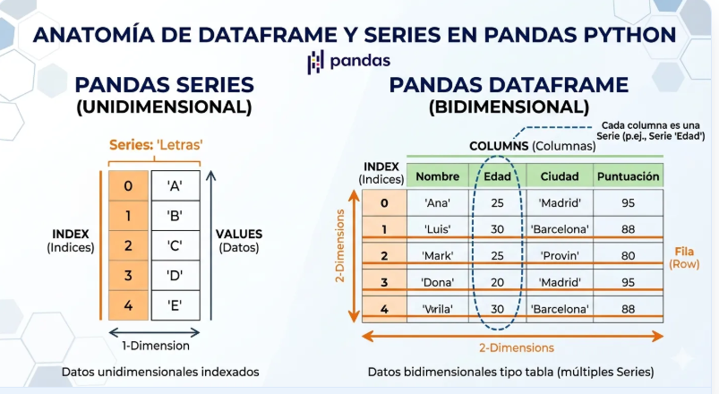
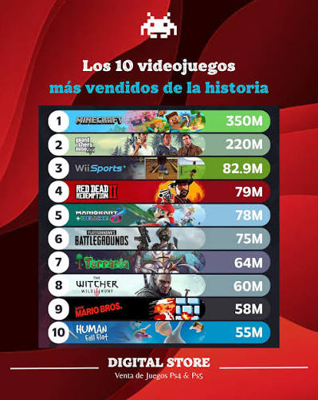
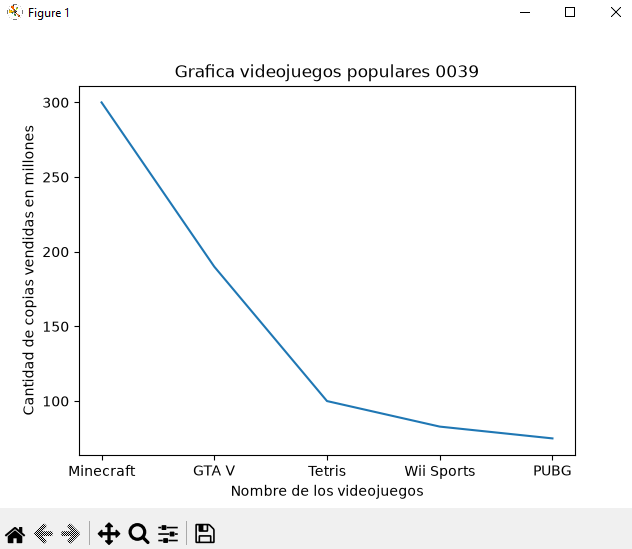
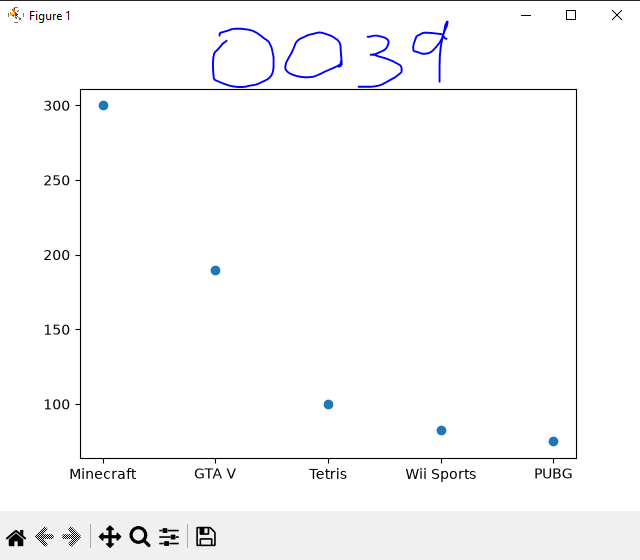
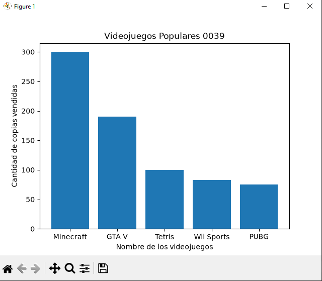
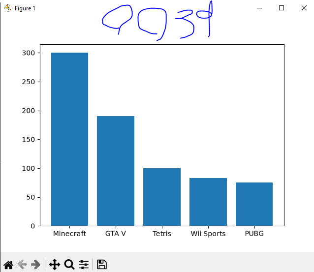
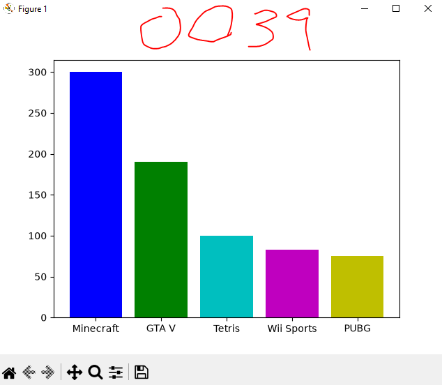
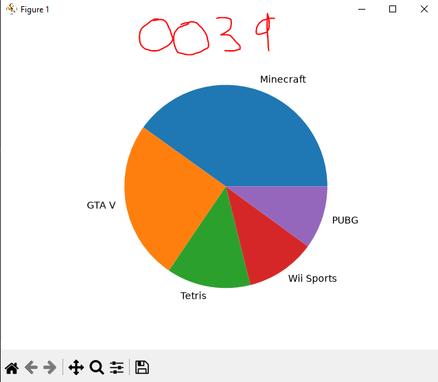

## Estructura de Dataframe o marco de datos

## Listado de videojuegos mas vendidos

## Grafica lineal videojuegos

## Grafica de puntos videojuegos

## Grafica de barras videojuegos

## Grafica de barras del mas grande al mas chico

## Coloreando la grafica

## Grafica pastel o pie
